# 📚 Mini Digital Library — Tugas CRUD PHP & MySQL

## 📌 Deskripsi Proyek
Proyek ini adalah sistem perpustakaan digital berbasis PHP Native + MySQL untuk tugas pemrograman web. Sistem memiliki dua hak akses yaitu **Admin** dan **Peminjam**, dilengkapi autentikasi session, cookie Remember Me, CRUD buku, upload sampul buku, serta fitur peminjaman buku.

## 🧩 Struktur Folder Proyek
```
web-perpustakaan-khoirun-2a
├── config/
│   └── koneksi.php
├── uploads/
│   └── .gitkeep
├── screenshot/
├── index.php
├── proses_login.php
├── logout.php
├── dashboard.php
├── tambah_buku.php
├── proses_tambah.php
├── edit_buku.php
├── proses_edit.php
├── hapus_buku.php
├── pinjam.php
├── proses_pinjam.php
├── peminjam_dashboard.php
├── daftar_peminjaman.php
├── style.css
├── db_perpustakaan.sql
└── README.md
```

## 🗄️ Struktur Database
### Tabel `user`
- id_user (PK)
- username
- password (md5)
- role (admin / peminjam)

### Tabel `buku`
- id_buku (PK)
- judul
- penulis
- kategori
- sampul (nama file)
- stok

### Tabel `peminjaman`
- id_peminjaman (PK)
- id_buku (FK)
- nama_peminjam
- tanggal_pinjam
- batas_kembali
- status_pinjam
- denda

## ✨ Fitur yang Sudah Diimplementasikan
### 🔐 Autentikasi & Hak Akses
✅ Login dengan Session
✅ Cookie Remember Me (menyimpan username selama 7 hari)
✅ Logout (hapus Session + Cookie)
✅ Pembatasan akses:
  - Admin: CRUD Buku, lihat daftar peminjaman
  - Peminjam: Hanya lihat peminjaman milik sendiri + pinjam buku

### 📚 Modul Buku (Admin)
✅ Create: Tambah buku + upload sampul
✅ Read: Tampil daftar buku + statistik
✅ Update: Edit buku + ganti sampul lama
✅ Delete: Hapus buku + hapus file sampul dari folder uploads
✅ Validasi upload:
  - Hanya ekstensi jpg / jpeg / png
  - Maksimal ukuran 2 MB
✅ Status stok: Tersedia / Sedang Dipinjam

### 📖 Modul Peminjaman
✅ Form pinjam (satu file untuk Admin & Peminjam)
✅ Nama peminjam otomatis untuk yang login
✅ Otomatis hitung batas kembali +7 hari
✅ Cek stok sebelum pinjam
✅ Kurangi stok buku setelah pinjam
✅ Dashboard peminjam: Hanya lihat data milik sendiri

## ⚙️ Langkah Instalasi Lokal
1. Pastikan XAMPP (Apache + MySQL) sudah berjalan
2. Buat database `db_perpustakaan` di phpMyAdmin
3. Import file `db_perpustakaan.sql`
4. Sesuaikan `config/koneksi.php`
5. Buka browser: `http://localhost/web-perpustakaan-khoirun-2a/index.php`

## 👤 Akun Demo
### Admin
- Username: `admin`
- Password: `123456`

### Peminjam
- Username: `siti`
- Password: `123456`

# 📸 Screenshot Sistem Mini Digital Library

## 1. Halaman Login
### Form Login Admin
> Halaman autentikasi untuk admin sebelum mengakses keseluruhan fitur sistem perpustakaan
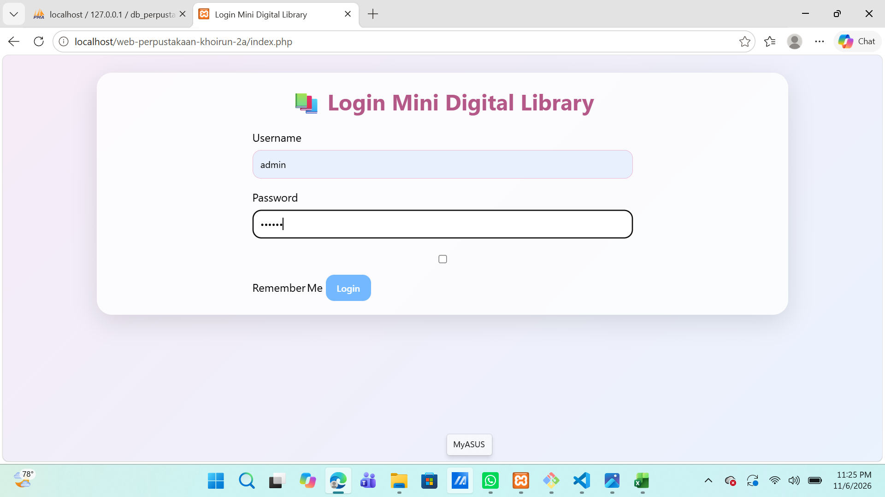

### Langkah 1: Centang Fitur Remember Me Sebelum Login
> Pengguna mencentang opsi Remember Me sebelum melakukan login ke sistem
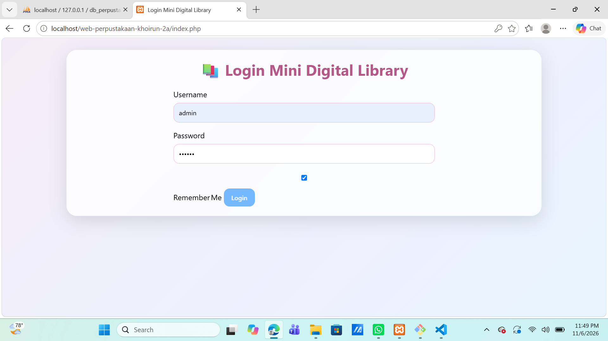

## 2. Dashboard Admin
### Dashboard Utama Admin
> Halaman utama admin yang menampilkan selamat datang, menu kelola buku, kelola peminjaman serta statistik buku
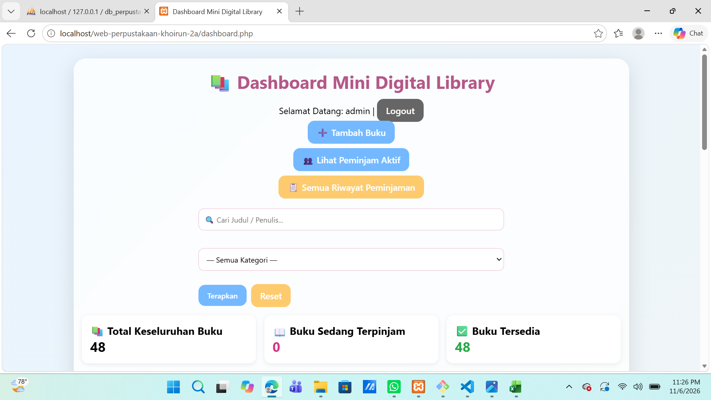

### Grafik Statistik Buku
> Grafik visualisasi untuk membandingkan jumlah buku yang sedang terpinjam dan buku yang masih tersedia
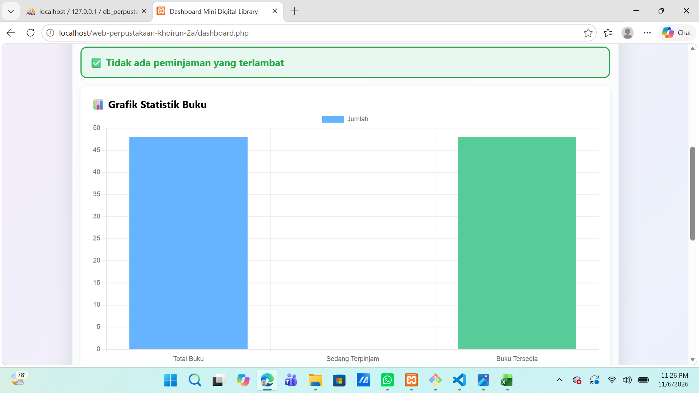

## 3. Kelola Buku (CRUD)
### Daftar Seluruh Buku
> Halaman menampilkan keseluruhan data buku beserta sampul buku, status ketersediaan dan tombol aksi Edit / Hapus
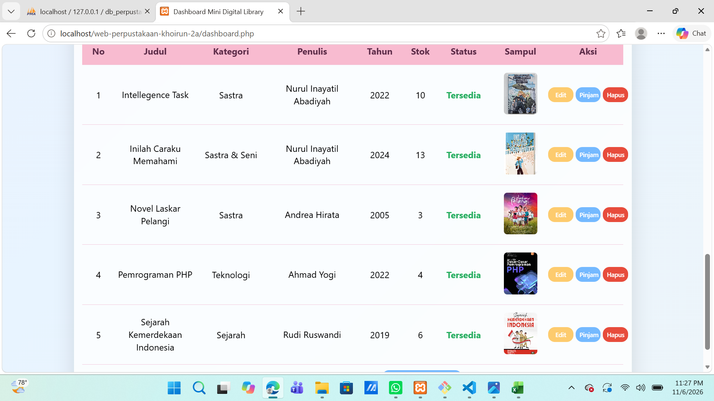

### Form Tambah Buku Baru (Utuh)
> Halaman form input untuk menambahkan data buku baru beserta fitur upload sampul buku
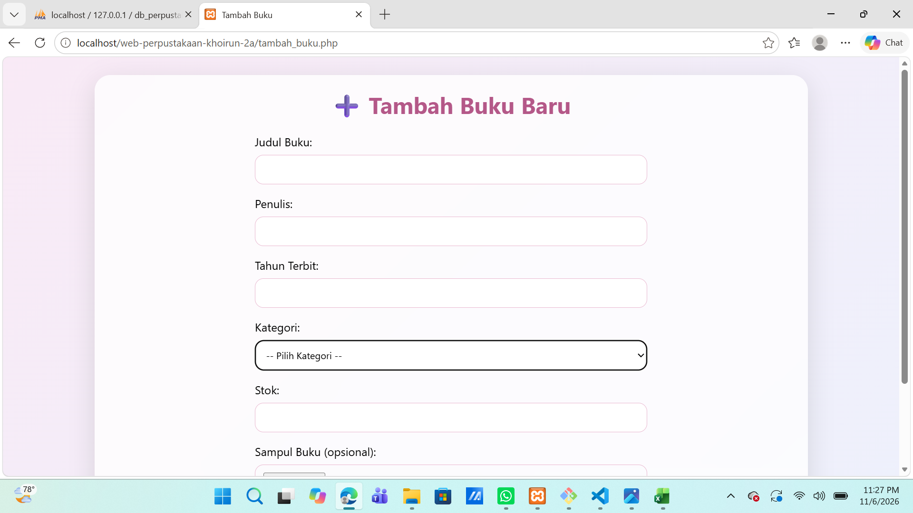

### Bagian Bawah Form Tambah Buku
> Bagian bawah form tambah buku untuk upload sampul dan tombol simpan
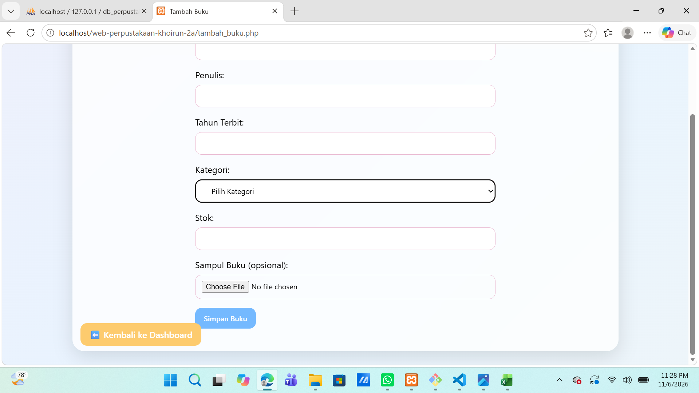

### Form Edit Buku
> Halaman untuk mengubah data buku yang sudah terdaftar, termasuk penggantian sampul buku jika dibutuhkan
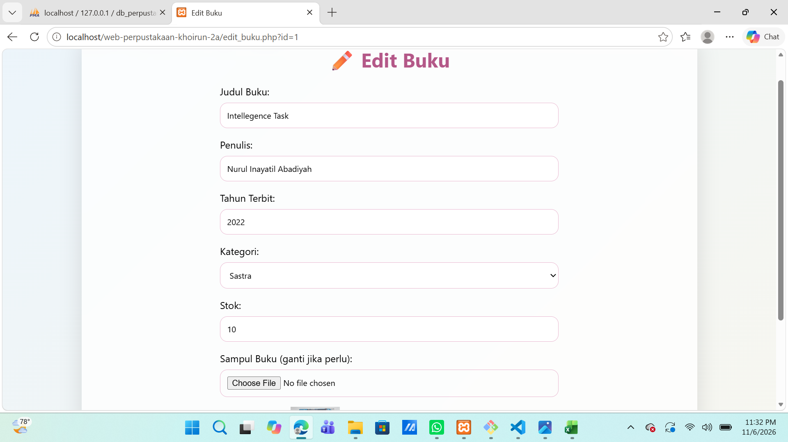

### Notifikasi Edit Buku Berhasil
> Pesan notifikasi yang muncul setelah data buku berhasil diperbarui melalui fitur edit
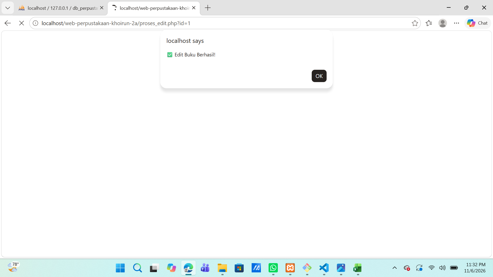

### Konfirmasi Hapus Buku
> Pop‑up konfirmasi yang muncul sebelum menghapus data buku guna menghindari penghapusan secara tidak sengaja
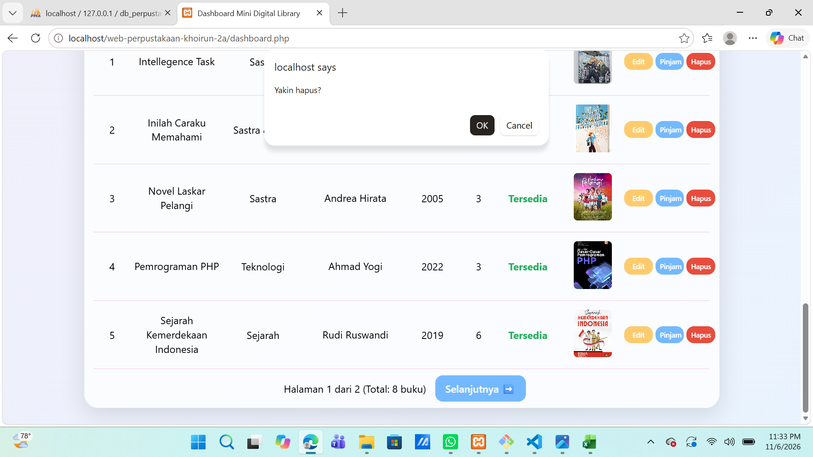

## 4. Kelola Peminjaman
### Daftar Peminjaman Buku (Admin)
> Halaman untuk melihat keseluruhan data peminjaman buku beserta status peminjaman dan tombol proses pengembalian
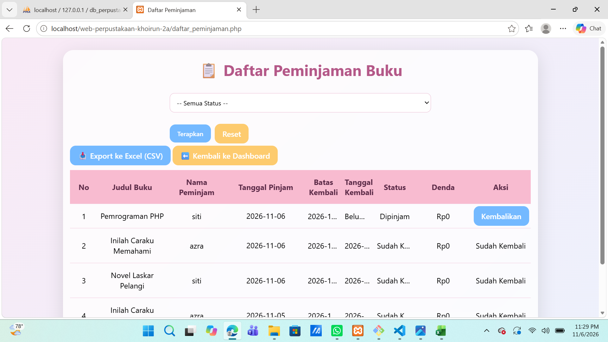

### Ekspor Data Peminjaman ke Excel
> Fitur untuk mengekspor seluruh data peminjaman buku menjadi file CSV guna keperluan laporan
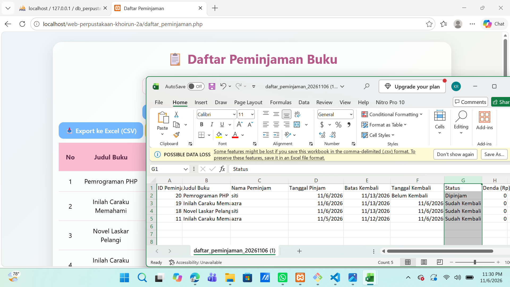

## 5. Modul untuk Peminjam

### 5.1 Form Login Peminjam
> Halaman login untuk peminjam sebelum dapat mengakses dashboard pribadi, dilengkapi fitur Remember Me
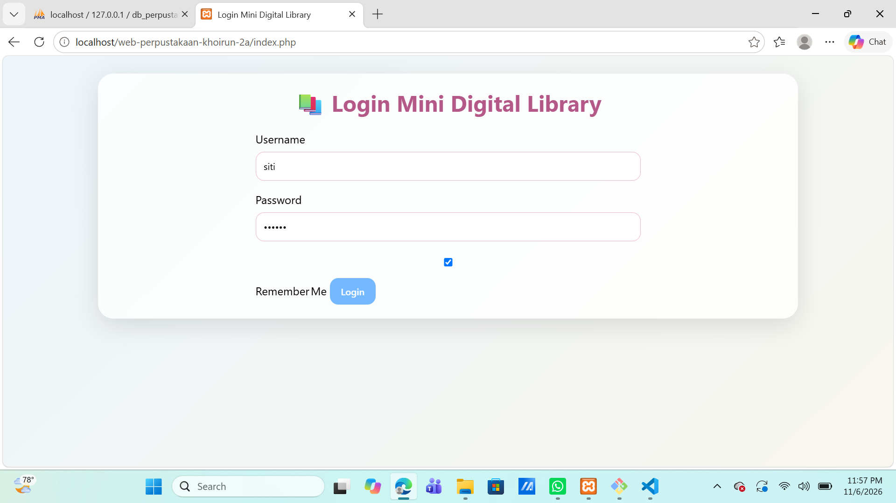

### 5.2 Dashboard Peminjam (Riwayat Peminjaman Milik Sendiri)
> Halaman utama peminjam setelah berhasil login, menampilkan tabel riwayat peminjaman buku milik peminjam saja yang berisi judul buku, penulis, tanggal pinjam, batas kembali, status peminjaman serta denda
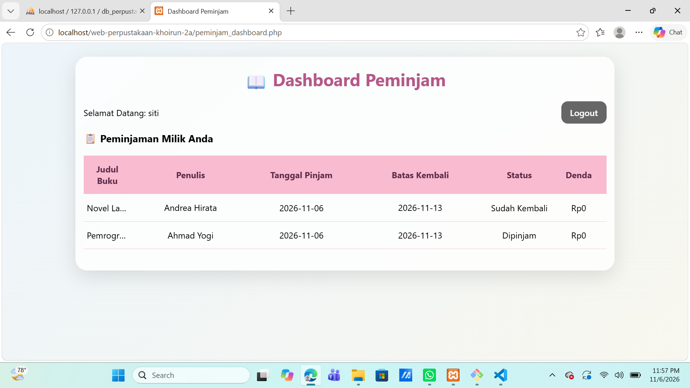

## 🎥 Demo Video
[Demo Mini Digital Library – Tugas Pemrograman Web](https://youtu.be/ASlQ7Gbm1Ew)